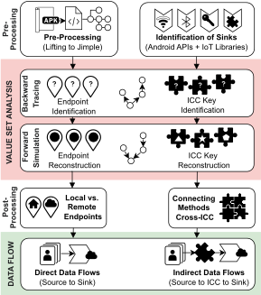

# IoTFlow - Artifact

## Overview



We use VSA to reconstruct endpoints, cryptographic data, and ICC keys for the flow analysis. We use flow analysis to find data leaks, and connect request/response data with endpoints. With the ICC information of the VSA, we support data flows involving ICC.

For more details, see [our paper "IoTFlow: Inferring IoT Device Behavior at Scale through Static Mobile Companion App Analysis"](./iotflow_paper.pdf) we presented at CCS 2023.

## Folder Structure

* [VSA](VSA/): value set analysis (IoTScope), with a [Docker setup](VSA/docker/). Its configuration (methods to analyse, exclusion lists) is in [VSA/docker/config](VSA/docker/config/).
* [FlowAnalysis](FlowAnalysis/): data flow analysis (FlowDroid 2.15.1 with IoTFlow's extensions), with a [Docker setup](FlowAnalysis/docker/). Its configuration, including a description of all sources and sinks, is in [FlowAnalysis/docker/config](FlowAnalysis/docker/config/).
* [scripts](scripts/): helper scripts to run the pipeline, and the scripts we used to evaluate the results and generate the paper's tables.
* [dependencies](dependencies/): `vsa.jar`, `android-31.jar`, dex2jar, shared by both stages (mounted read-only).
* [patches](patches/): bytecode patches applied to the bundled jars, each with a README, and the validation of the FlowDroid upgrade.
* [Datasets](datasets/): app ids and version codes of the apps used in the paper. [dynamic_analysis](dynamic_analysis/): data of the paper's dynamic analysis.
* [CHANGES.md](CHANGES.md): what was changed compared to the original artifact, and why.

## Quickstart

Requirements: Docker (your user in the `docker` group), about 30 GB of RAM for medium-sized apps (64 GB for very large apps such as Tuya Smart Life or TP-Link Tapo), Java 11+ and Python 3 on the host for the jar conversion.

1. **Get the base APK.** From an `.xapk` / `.apks` bundle, take the APK named after the package (e.g. `unzip -p app.xapk com.example.app.apk > com.example.app.apk`); the `config.*.apk` splits contain only native libraries and resources.
2. **Add it to both stages:** copy it into `VSA/docker/apps_to_analyze/` and `FlowAnalysis/docker/apps_to_analyze/`.
3. **Convert it to a jar** (needed by the VSA simulation; dex2jar fails on large apps when run inside the containers):
   ```bash
   scripts/apk2jar.sh VSA/docker/apps_to_analyze/com.example.app.apk
   ```
4. **Run both stages, detached from the terminal** (VSA first, then the flow analysis; several hours per app):
   ```bash
   setsid nohup scripts/run_pipeline.sh > /dev/null 2>&1 &
   ```
   On a 64 GB machine: `VSA_PARALLEL=3 VSA_XMX_SMALL=16g VSA_XMX=44g MMF=30 MMI=12 setsid nohup scripts/run_pipeline.sh > /dev/null 2>&1 &`.
   Keep the machine awake (closing a laptop lid suspends the analysis). The containers run as your user, so all results belong to you.
5. **Follow it:** `cat apps/pipeline.log` (stages, exit codes), `grep -aE "Analysing:" apps/vsa_run.log` (current app), `docker stats --no-stream` (memory).
6. **Results:** `VSA/docker/results/<analysis>/<package>.json` and `FlowAnalysis/docker/results/...` (see the two Docker READMEs). Fatal errors that stopped an analysis are collected in `VSA/docker/results/<analysis>/<package>.error` and `FlowAnalysis/docker/results/errors/<package>.log`.
7. **Summarise:** `python3 -I scripts/summarize.py <package> -o summary.md` (status, errors, endpoints by host, crypto/UDP/MQTT/WebView values, data flows).
8. **Repeat runs that ran out of memory**, e.g. on a larger machine: `python3 -I scripts/reset_incomplete.py --apply`, then start the pipeline again with more memory; everything else is skipped.

To run a single stage: `HOST_UID=$(id -u) HOST_GID=$(id -g) docker compose up --build vsa` (or `dfa`) from this folder.

Settings (memory, time limits, analyses, exclusion lists) are environment variables; see the tables in [VSA/docker/README.md](VSA/docker/README.md) and [FlowAnalysis/docker/README.md](FlowAnalysis/docker/README.md).

**Privacy:** nothing is sent to third parties by default. `FlowAnalysis/docker/scripts/iotflow.py --deguard` would upload the APK to apk-deguard.com for deobfuscation.

## How to cite:

```
@inproceedings{iotflow:ccs2023,
  title     = {{IoTFlow: Inferring IoT Device Behavior at Scale through Static Mobile Companion App Analysis}},
  author    = {Schmidt, David and Tagliaro, Carlotta and Borgolte, Kevin and Lindorfer, Martina},
  booktitle = {Proceedings of the 30th ACM SIGSAC Conference on Computer and Communications Security (CCS)},
  date      = {2023-11},
  doi       = {10.1145/3576915.3623211},
  edition   = {30},
  editor    = {Cremers, Cas and Kirda, Engin},
  location  = {Copenhagen, Denmark},
  publisher = {Association for Computing Machinery (ACM)},
}
```

## Contacts
* David Schmidt:
    * email: dschmidt@seclab.wien
    * bsky: @dschm1dt.bsky.social
    * twitter: @dschm1dt
* Carlotta Tagliaro:
    * email: carlotta@seclab.wien
    * twitter: @Pseudorandomico
* Kevin Borgolte
    * email: kevin.borgolte@rub.de
    * twitter: @caovc
* Martina Lindorfer
    * email: martina@seclab.wien
    * twitter: @lindorferin
